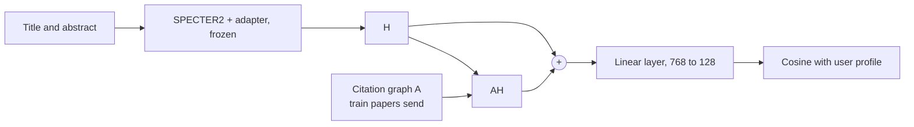

# When Do Citations Help? A Unified Benchmark of Content, Collaborative and Graph Methods for Scientific Paper Recommendation

*PaperRec Project, IT4868E Web Mining*

## Abstract

We compare thirteen recommenders on CiteULike-a under one protocol: the same five warm-start and five cold-start folds, the same candidate pools and the same metrics. The methods cover lexical retrieval, topic models, collaborative filtering, pretrained text encoders, random-walk graph embeddings and graph convolution over citations. Three results stand out. First, in warm-start, weighted matrix factorization reaches a test Recall@20 of 0.522 and a simple item-based nearest-neighbour model 0.450, both above every content and citation-graph model we tested. Second, in cold-start those collaborative models fall to chance, and a residual graph convolution over SPECTER2 features is best, with a Recall@20 of 0.400 against 0.387 for the same network without citations. Third, this average gain hides a reversal. The residual model gains 0.117 hit rate on held-out papers with at least eight visible citations and loses 0.066 on papers with none. A newly published paper has no citations, so the model that wins on average is not the one to prefer for the papers where cold-start matters most.

## 1. Introduction
Recommending papers to researchers involves two different problems. For papers that other users have already saved, behaviour is a strong signal. For new papers no behaviour exists, and a system must rely on text, citations or both. Results for these two settings are often reported for different methods, on different splits, which makes it hard to say which kind of signal matters when.

This paper reports a single benchmark for both settings on CiteULike-a. All methods share their folds, candidate pools, metrics and tie-breaking. Our main question is whether citations improve recommendation beyond a strong pretrained text encoder, and for which papers. We make three contributions.

- A unified warm-start and cold-start benchmark of thirteen methods, with settings chosen on validation data and leakage rules for the citation graph.
- A control experiment that separates the effect of citations from the effect of training: the same network, loss and training data, with and without the graph.
- An error analysis showing that the benefit of citations depends on how many citations a paper has and on whether they lead to the user's own library.

## 2. Related Work
**Content and topic models.** TF-IDF weighting [12] and BM25 [11] are standard lexical methods. Latent semantic indexing [4] and latent Dirichlet allocation [1] represent documents in a lower-dimensional space. Collaborative topic regression [15] joins topic models with matrix factorization and introduced the in-matrix and out-of-matrix evaluation that our warm and cold settings follow. CiteULike-a was released with its socially regularized extension [16].

**Collaborative filtering.** Item-based nearest neighbours [13] and weighted matrix factorization for implicit feedback [8] are long-standing methods. Later studies found that well-tuned versions of such methods are hard to beat [3, 10]. Our warm-start results agree.

**Pretrained document encoders.** SPECTER [2] trains a transformer on citation links. SPECTER2, released with SciRepEval [14], adds task-specific adapters.

**Graph methods.** Node2Vec [5] learns embeddings from biased random walks. Graph convolutional networks [9] average features over neighbours, and SGC [17] and LightGCN [7] show that much of their benefit remains without nonlinearities. PR-SGCN [6] combines SPECTER with graph convolution for paper recommendation, on other datasets. Our plain GCN is a simplified adaptation to CiteULike-a and not a reproduction of that method.

## 3. Methodology
### 3.1 Setting
Let $\mathbf{R}\in\{0,1\}^{U\times I}$ hold the saves of $U$ users on $I$ papers. For user $u$ with training saves $\mathcal{P}_u$, a model scores all candidate papers and ranks them. Except for the two collaborative models, every method maps paper $i$ to a vector $\mathbf{z}_i$ and, with BM25 also excepted, scores it by its cosine with the user's profile,

$$
s(u,i)=\frac{\mathbf{z}_i^\top\mathbf{c}_u}{\lVert\mathbf{z}_i\rVert\,\lVert\mathbf{c}_u\rVert},\qquad \mathbf{c}_u=\sum_{j\in\mathcal{P}_u}\frac{\mathbf{z}_j}{\lVert\mathbf{z}_j\rVert}.
$$

BM25 uses the distinct terms of the profile as its query.

### 3.2 Methods
**Lexical and topic.** TF-IDF and BM25 ($k_1=1.2$, $b=0.75$) use default settings. LSI uses 300 dimensions and LDA 150 topics. All text statistics are fitted on training papers only.

**Collaborative.** ItemKNN sums the cosine similarity between a candidate and the saved papers, keeping 400 neighbours per paper. Weighted matrix factorization (WMF) minimizes

$$
\sum_{(u,i)}w_{ui}\,(r_{ui}-\mathbf{x}_u^\top\mathbf{y}_i)^2+\lambda\Big(\sum_u\lVert\mathbf{x}_u\rVert^2+\sum_i\lVert\mathbf{y}_i\rVert^2\Big)
$$

by alternating least squares, with $w_{ui}=1+\alpha r_{ui}$ for training pairs and $w_{ui}=0$ for held-out pairs. A control version gives held-out pairs weight 1, as common libraries do.

**Pretrained text.** SPECTER2 encodes title and abstract into 768 dimensions. We test the base encoder alone and the base encoder with the proximity adapter. Neither is trained further.

**Node2Vec.** We embed the citation graph and, for warm-start only, the user–paper graph of training saves (128 dimensions, 10 walks of length 80; $p=4,q=1$ for warm citations, $p=0.25,q=1$ for the user–paper graph and $p=q=1$ when cold). When cold, a held-out paper receives the mean embedding of its citation neighbours among training papers.

**Learned projection and graph convolution.** Let $\mathbf{H}$ hold the L2-normalized SPECTER2 features with the proximity adapter. Three models share one linear layer $\phi$ with 128 outputs:

$$
\begin{aligned}
\texttt{nograph-bce}:&\quad \mathbf{Z}=\phi(\mathbf{H})\\
\texttt{gcn-bce}:&\quad \mathbf{Z}=\phi(\mathbf{A}\mathbf{H})\\
\texttt{gcn-bce-add}:&\quad \mathbf{Z}=\phi(\mathbf{H}+\mathbf{A}\mathbf{H})
\end{aligned}
$$

where rows of $\mathbf{Z}$ are L2-normalized and $\mathbf{A}$ is the citation graph with self-loops, weighted by $1/\sqrt{d_i d_j}$. Here $d_i$ counts the messages paper $i$ receives, plus one. Training uses leave-one-out triplets: one saved paper is the positive, the user's other saved papers form the profile, and five unsaved papers from the training pairs are negatives. The loss is binary cross-entropy on ten times the cosine. Because the three models differ only in their input to $\phi$, any gap between them is due to the graph. Figure 1 shows the pipeline.

**Figure 1.** The residual model `gcn-bce-add`. Removing the lower path gives `nograph-bce`; removing the direct path from $\mathbf{H}$ to the sum gives `gcn-bce`.

### 3.3 Leakage rules for citations
Citations are metadata and are not derived from saves, so warm models use all of them. When cold, the training graph keeps only edges between training papers. At inference a held-out paper receives messages from training papers but sends none, so training embeddings do not depend on held-out papers and validation and test papers cannot influence each other. Edges between two held-out papers are excluded.

## 4. Experimental Setup
**Data.** CiteULike-a has 5,551 users, 16,980 papers, 204,986 saves and 44,661 undirected citation links after removing self-loops. No citation is recorded for 31.2% of the papers.

**Splits.** Each setting has five folds with roughly 70/10/20 train, validation and test data. Warm folds split user–paper pairs within each paper; papers with fewer than five saves stay in training. Cold folds hold out whole papers. Candidates are all pairs assigned to the evaluated partition, saved or not. Every model of a setting was checked to have used identical split fingerprints.

**Metrics.** We report Recall@$k$, NDCG@$k$ and MRR, averaged over users and then over folds; $\pm$ is the sample standard deviation over folds. Confidence intervals resample users with 2,000 bootstrap draws, after averaging each user over folds. Scores that tie are ordered by a fixed seeded permutation.

**Model selection.** No setting was chosen on test data. ItemKNN and WMF were tuned on the validation part of warm fold 0 by NDCG@20, selecting 400 neighbours, and 128 factors with $\alpha=40$ and $\lambda=10$. Node2Vec and the network settings had been chosen on validation fold 0 earlier in the project, and the LSI and LDA sizes by five-fold validation. The residual model was designed after seeing that the plain GCN lost to the no-graph model on validation, so its validation score is optimistic. Tuning effort was not equal: TF-IDF and BM25 were not tuned at all.

**Compute.** All methods were run on Kaggle. Encoding and WMF used a T4 GPU; the networks were trained on CPU with seed 42. The content, Node2Vec-citation and network scores agree with earlier independent runs on a different machine to about three or four decimals.

## 5. Benchmark Results
Table 1 and Table 2 give the test results. Validation results, all cutoffs and per-fold values are in `results/benchmark`. Test and validation recall should not be compared with each other, because test holds out about twice as many saves per user.

**Table 1.** Warm-start test results (mean over five folds). Best value in bold.

| Model | R@10 | R@20 | R@50 | NDCG@10 | NDCG@20 | MRR |
|---|---|---|---|---|---|---|
| TF-IDF | 0.1773 | 0.2520 ± 0.0023 | 0.3667 | 0.1606 | 0.1857 | 0.2682 |
| BM25 | 0.1179 | 0.1727 ± 0.0027 | 0.2699 | 0.1040 | 0.1234 | 0.1913 |
| LSI ($K{=}300$) | 0.1798 | 0.2597 ± 0.0019 | 0.3796 | 0.1668 | 0.1923 | 0.2803 |
| LDA ($K{=}150$) | 0.0792 | 0.1293 ± 0.0042 | 0.2330 | 0.0755 | 0.0913 | 0.1540 |
| ItemKNN | 0.3429 | 0.4503 ± 0.0017 | 0.5947 | 0.3532 | 0.3814 | 0.5004 |
| WMF (masked) | **0.3931** | 0.5222 ± 0.0037 | 0.6757 | 0.3935 | 0.4303 | 0.5440 |
| WMF (unmasked control) | 0.3930 | **0.5228** ± 0.0052 | **0.6762** | **0.3957** | **0.4320** | **0.5487** |
| SPECTER2 base | 0.2176 | 0.3160 ± 0.0015 | 0.4803 | 0.1959 | 0.2282 | 0.3092 |
| SPECTER2 + adapter | 0.2212 | 0.3223 ± 0.0020 | 0.4869 | 0.2006 | 0.2338 | 0.3174 |
| Node2Vec citation | 0.1607 | 0.2355 ± 0.0020 | 0.3519 | 0.1433 | 0.1692 | 0.2352 |
| Node2Vec bipartite | 0.2498 | 0.3584 ± 0.0032 | 0.5236 | 0.2480 | 0.2801 | 0.3765 |
| Plain GCN (`gcn-bce`) | 0.2656 | 0.3820 ± 0.0026 | 0.5570 | 0.2538 | 0.2899 | 0.3893 |
| No graph (`nograph-bce`) | 0.2833 | 0.4019 ± 0.0021 | 0.5744 | 0.2687 | 0.3052 | 0.4075 |
| Residual GCN (`gcn-bce-add`) | 0.2959 | 0.4150 ± 0.0018 | 0.5867 | 0.2853 | 0.3213 | 0.4326 |

**Table 2.** Cold-start test results (mean over five folds). Best value in bold. †: no signal for unseen papers, so the ranking is a random permutation. Node2Vec on the user–paper graph cannot embed cold papers and is omitted.

| Model | R@10 | R@20 | R@50 | NDCG@10 | NDCG@20 | MRR |
|---|---|---|---|---|---|---|
| TF-IDF | 0.1752 | 0.2489 ± 0.0104 | 0.3619 | 0.1598 | 0.1846 | 0.2683 |
| BM25 | 0.1141 | 0.1661 ± 0.0052 | 0.2614 | 0.1019 | 0.1204 | 0.1898 |
| LSI ($K{=}300$) | 0.1758 | 0.2529 ± 0.0043 | 0.3711 | 0.1640 | 0.1885 | 0.2781 |
| LDA ($K{=}150$) | 0.0799 | 0.1306 ± 0.0062 | 0.2306 | 0.0758 | 0.0922 | 0.1570 |
| ItemKNN† | 0.0041 | 0.0068 ± 0.0018 | 0.0153 | 0.0040 | 0.0048 | 0.0153 |
| WMF (masked)† | 0.0041 | 0.0068 ± 0.0018 | 0.0153 | 0.0040 | 0.0048 | 0.0153 |
| SPECTER2 base | 0.2086 | 0.3061 ± 0.0046 | 0.4643 | 0.1898 | 0.2225 | 0.3048 |
| SPECTER2 + adapter | 0.2152 | 0.3120 ± 0.0028 | 0.4734 | 0.1969 | 0.2289 | 0.3155 |
| Node2Vec citation | 0.1779 | 0.2463 ± 0.0078 | 0.3433 | 0.1776 | 0.1972 | 0.3088 |
| Plain GCN (`gcn-bce`) | 0.2551 | 0.3676 ± 0.0088 | 0.5418 | 0.2460 | 0.2811 | 0.3853 |
| No graph (`nograph-bce`) | 0.2744 | 0.3873 ± 0.0036 | 0.5599 | 0.2627 | 0.2973 | 0.4037 |
| Residual GCN (`gcn-bce-add`) | **0.2858** | **0.4000** ± 0.0069 | **0.5709** | **0.2778** | **0.3123** | **0.4276** |

**Warm-start.** Collaborative models lead clearly. WMF reaches a Recall@20 of 0.5222 and ItemKNN 0.4503, against 0.4150 for the best citation model. The WMF lead does not come from masking held-out pairs: the unmasked control scores 0.5228. We also checked that the mask carries no label information. Saves and non-saves are held out at the same rate (19.98% and 20.00% on fold 0), and the share held out per user is unrelated to the number of saves. ItemKNN never uses the mask.

**Cold-start.** ItemKNN and WMF score 0.0068, identical to each other, because both give every unseen paper a score of zero. Text models change little from warm to cold. The residual GCN is best at 0.4000.

**What citations add.** Table 3 isolates each step. Training a linear projection on saves gives the largest gain, $+0.075$ Recall@20 over SPECTER2 in cold-start. Replacing the features with their neighbourhood average, as the plain GCN does, loses $0.020$. Adding the average to the features instead gains $0.013$. These signs hold in all five folds and both settings. The proximity adapter gives a small gain over the base encoder, about $0.006$.

**Table 3.** Paired test differences, with user-bootstrap 95% intervals and the number of folds in which the first model is higher.

| Setting | Comparison | R@20 gap | 95% interval | Folds | NDCG@20 gap | 95% interval | Folds |
|---|---|---|---|---|---|---|---|
| Warm | Residual GCN − no graph | $+0.0131$ | [$+0.0109$, $+0.0150$] | 5/5 | $+0.0161$ | [$+0.0143$, $+0.0174$] | 5/5 |
| Warm | Plain GCN − no graph | $-0.0199$ | [$-0.0230$, $-0.0175$] | 0/5 | $-0.0152$ | [$-0.0179$, $-0.0134$] | 0/5 |
| Warm | No graph − SPECTER2 + adapter | $+0.0796$ | [$+0.0768$, $+0.0832$] | 5/5 | $+0.0714$ | [$+0.0687$, $+0.0737$] | 5/5 |
| Warm | SPECTER2 adapter − base | $+0.0063$ | [$+0.0037$, $+0.0085$] | 5/5 | $+0.0056$ | [$+0.0039$, $+0.0069$] | 5/5 |
| Cold | Residual GCN − no graph | $+0.0127$ | [$+0.0107$, $+0.0147$] | 5/5 | $+0.0150$ | [$+0.0135$, $+0.0164$] | 5/5 |
| Cold | Plain GCN − no graph | $-0.0198$ | [$-0.0226$, $-0.0171$] | 0/5 | $-0.0162$ | [$-0.0184$, $-0.0142$] | 0/5 |
| Cold | No graph − SPECTER2 + adapter | $+0.0753$ | [$+0.0718$, $+0.0778$] | 5/5 | $+0.0684$ | [$+0.0655$, $+0.0701$] | 5/5 |
| Cold | SPECTER2 adapter − base | $+0.0059$ | [$+0.0036$, $+0.0083$] | 4/5 | $+0.0064$ | [$+0.0049$, $+0.0079$] | 5/5 |

## 6. Error Analysis: Citations in Cold-Start
We compare `gcn-bce-add` with `nograph-bce` on cold test papers. Over the five folds there are 204,986 held-out user–paper pairs. The residual model alone finds 10,926 of them in its top 20, the no-graph model alone finds 8,627, both find 55,695 and neither finds 129,738. Per user and fold, Recall@20 improves in 21% of cases, worsens in 15% and ties in the rest. The net gain is therefore the difference between two large opposing effects.

### 6.1 The gain reverses with the number of citations
Figure 2 and Table 4 group held-out pairs by the number of citations visible to the model at inference. The no-graph model is nearly flat across groups. The residual model rises from 0.2459 for papers with no citations to 0.4360 for papers with eight or more. It is worse than the no-graph model in all five folds for papers with zero or one citation, which make up 44% of the pairs.

| Citations | No graph | Plain GCN | Residual GCN |
|---|---|---|---|
| 0 | 0.3115 | 0.2187 | 0.2459 |
| 1 | 0.2976 | 0.2335 | 0.2615 |
| 2–3 | 0.3078 | 0.2924 | 0.3117 |
| 4–7 | 0.3256 | 0.3889 | 0.3866 |
| 8+ | 0.3195 | 0.3885 | 0.4360 |

**Figure 2.** Cold-start hit rate by number of visible citations (test, mean of five folds). Values are in Table 4.

**Table 4.** Cold-start test hit rate@20 by number of visible citations. Pooled over pairs, so it differs from user-averaged Recall@20.

| Model | 0 | 1 | 2–3 | 4–7 | 8+ |
|---|---|---|---|---|---|
| SPECTER2 + adapter | 0.2345 | 0.2037 | 0.2159 | 0.2384 | 0.2784 |
| No graph | **0.3115** | **0.2976** | 0.3078 | 0.3256 | 0.3195 |
| Plain GCN | 0.2187 | 0.2335 | 0.2924 | **0.3889** | 0.3885 |
| Residual GCN | 0.2459 | 0.2615 | **0.3117** | 0.3866 | **0.4360** |
| Residual − no graph | $-0.0656$ | $-0.0361$ | $+0.0039$ | $+0.0610$ | $+0.1165$ |
| Folds above | 0/5 | 0/5 | 4/5 | 5/5 | 5/5 |
| Share of pairs | 33.6% | 10.2% | 16.3% | 18.3% | 21.6% |

### 6.2 Papers without citations are pushed out of the top 20
Papers with no visible citation make up 35.4% of the cold test pool and 33.6% of the held-out pairs. The no-graph model gives them 33.0% of all top-20 slots, close to their share. The residual model gives them 21.9%, and the plain GCN 18.8%. Papers with eight or more citations go from 18.4% of slots without the graph to 28.1% with the residual model, although they are only 15.0% of the pool. A top-20 list is a fixed budget, so part of the gain for cited papers is paid for by uncited ones.

### 6.3 The gain comes from links into the user's own library
Table 5 groups the same pairs by whether the held-out paper has a citation link to a paper that the user has already saved. With two or more such links the residual model gains 0.137 hit rate. With one it gains 0.058. With citations that do not touch the user's library it gains only 0.009. The graph therefore helps mostly where a citation connects directly to the user's history. It adds little through citations to other papers.

**Table 5.** Cold-start test hit rate@20 by citation links between the held-out paper and the user's saved papers.

| Model | No citations | Cited, no link to profile | One link | Two or more links |
|---|---|---|---|---|
| SPECTER2 + adapter | 0.2345 | 0.1611 | 0.2687 | 0.3939 |
| No graph | **0.3115** | 0.2098 | 0.3717 | 0.4983 |
| Plain GCN | 0.2187 | 0.1965 | 0.4139 | 0.5988 |
| Residual GCN | 0.2459 | **0.2184** | **0.4293** | **0.6357** |
| Residual − no graph | $-0.0656$ | $+0.0086$ | $+0.0576$ | $+0.1373$ |
| Folds above | 0/5 | 5/5 | 5/5 | 5/5 |
| Share of pairs | 33.6% | 35.4% | 15.4% | 15.5% |

### 6.4 Two example users
Examples were selected by rule: in fold 0, among users with at least five held-out papers, the user with the largest loss and the user with the largest gain. They illustrate the pattern but do not measure it.

**Largest loss (user 3543, 24 saved papers, Recall@20 $-0.40$).** The library covers boosting and support vector machines. The no-graph model finds “Bagging, Boosting, and C4.5” (no visible citations) and “A Tutorial on Support Vector Machines for Pattern Recognition” (seven citations, none to this library). The residual model misses both. Both models find “Improved boosting algorithms using confidence-rated predictions”, which has two links to the library.

**Largest gain (user 1335, 17 saved papers, Recall@20 $+0.50$).** The library covers wikis and online collaboration. Only the residual model finds “Internet encyclopaedias go head to head”, “Creating, Destroying, and Restoring Value in Wikipedia” and a paper on collaborative knowledge sharing, which have two, seven and two citations. Neither model finds “Social Rewarding in Wiki Systems”, which is on topic but has no visible citations. Two of the three gained papers have no direct link to the library, so this case is an exception to the trend in Table 5.

### 6.5 Why uncited papers lose, and what we do not know
Two explanations are consistent with the data. Averaging moves cited papers toward the neighbourhoods that also form most user profiles, which would leave uncited papers further from the profile. The projection is also trained mostly on cited papers and may adapt to their features. We have tested neither. Earlier validation experiments on fold 0 that normalized $\mathbf{A}\mathbf{H}$ by row or by length did not recover the uncited group, which suggests that input magnitude alone is not the cause.

### 6.6 Implication for new papers
A paper published today has no citations, so it belongs to the first column of Table 4, where the no-graph model is better by 0.066. For such papers we recommend `nograph-bce`. Choosing a model by the number of citations is a natural next step, but scores from two models are not directly comparable and we have not tested it.

**Limitations.** The citation links are undated and undirected, so a held-out paper's links may include papers that cited it later. Cold scores of the citation models are therefore optimistic. SPECTER2 was trained on external citation data that may overlap these papers. The number of citations may be confounded with topic and popularity, so the group analysis is observational. The five folds share data and are not independent. Test results use one seed. The best WMF setting lies at the edge of its grid (128 factors), so WMF may be under-tuned. Results cover one dataset.

## 7. Conclusion
Which signal works best depends on the paper being recommended. Where saves exist, collaborative filtering is well ahead and citations do not close the gap. Where they do not, a projection of SPECTER2 features learned from saves gives most of the gain, and citations add a smaller one that only appears when the paper's own features are kept. That gain is concentrated in papers that already have citations, especially to papers in the user's library. For papers without citations the graph is harmful. Average cold-start scores on undated citation graphs should be read together with a breakdown by citation count.

## References

1. D. M. Blei, A. Y. Ng, and M. I. Jordan. Latent Dirichlet allocation. *JMLR*, 3:993–1022, 2003.
2. A. Cohan, S. Feldman, I. Beltagy, D. Downey, and D. S. Weld. SPECTER: Document-level representation learning using citation-informed transformers. In *ACL*, 2020.
3. M. Ferrari Dacrema, P. Cremonesi, and D. Jannach. Are we really making much progress? A worrying analysis of recent neural recommendation approaches. In *RecSys*, 2019.
4. S. Deerwester, S. T. Dumais, G. W. Furnas, T. K. Landauer, and R. Harshman. Indexing by latent semantic analysis. *JASIS*, 41(6):391–407, 1990.
5. A. Grover and J. Leskovec. node2vec: Scalable feature learning for networks. In *KDD*, 2016.
6. P. Guo, G. Zhou, J. Lu, Z. Li, and T. Zhu. A paper recommendation method based on SPECTER and graph convolutional networks. *Advances in Engineering Innovation*, 16(3):65–74, 2025.
7. X. He, K. Deng, X. Wang, Y. Li, Y. Zhang, and M. Wang. LightGCN: Simplifying and powering graph convolution network for recommendation. In *SIGIR*, 2020.
8. Y. Hu, Y. Koren, and C. Volinsky. Collaborative filtering for implicit feedback datasets. In *ICDM*, 2008.
9. T. N. Kipf and M. Welling. Semi-supervised classification with graph convolutional networks. In *ICLR*, 2017.
10. S. Rendle, W. Krichene, L. Zhang, and Y. Koren. Revisiting the performance of iALS on item recommendation benchmarks. In *RecSys*, 2022.
11. S. Robertson and H. Zaragoza. The probabilistic relevance framework: BM25 and beyond. *Foundations and Trends in Information Retrieval*, 3(4):333–389, 2009.
12. G. Salton and C. Buckley. Term-weighting approaches in automatic text retrieval. *Information Processing & Management*, 24(5):513–523, 1988.
13. B. Sarwar, G. Karypis, J. Konstan, and J. Riedl. Item-based collaborative filtering recommendation algorithms. In *WWW*, 2001.
14. A. Singh, M. D'Arcy, A. Cohan, D. Downey, and S. Feldman. SciRepEval: A multi-format benchmark for scientific document representations. In *EMNLP*, 2023.
15. C. Wang and D. M. Blei. Collaborative topic modeling for recommending scientific articles. In *KDD*, 2011.
16. H. Wang, B. Chen, and W.-J. Li. Collaborative topic regression with social regularization for tag recommendation. In *IJCAI*, 2013.
17. F. Wu, A. Souza, T. Zhang, C. Fifty, T. Yu, and K. Weinberger. Simplifying graph convolutional networks. In *ICML*, 2019.
